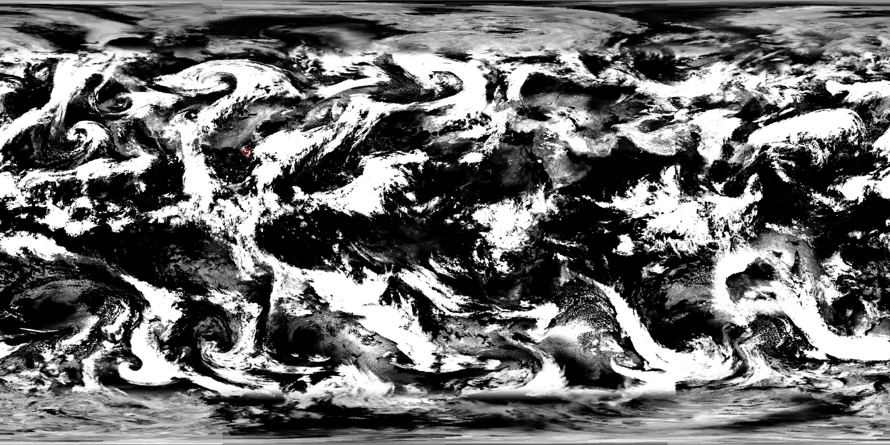

# KSA Live Clouds

Earth's clouds in Kitten Space Agency, as they really are right now.

Stock Earth has one painted cloud map that slowly slides around the planet. Live Clouds swaps it for today's
weather from NOAA's hourly satellite image of the whole globe. If it's clear over the Cape today, it's clear
over the Cape in the game.

A [StarMap](https://github.com/StarMapLoader/StarMap) mod. **0.1.0 is a pre-release.** The cloud swap at
launch has been seen working in game. The hourly crossfade and the time-warp drift have only been tested
outside the game so far, so reports are welcome.

## What it does

- **At launch:** it downloads NOAA's newest Global Mosaic of Geostationary Satellite Imagery (GMGSI), the
  longwave infrared image, about 7 MB. It turns that into KSA cloud maps in about 5 seconds, while the game is
  still loading.
- **Both of Earth's cloud layers:**
  - The volumetric clouds from 2 km up follow real cloud.
  - The cirrus at 11 km follows the coldest, highest cloud tops.
  - Cirrus over clear ground no longer draws a low deck as well.
- **Cloud types:** smooth decks lean stratus, and lumpy fields of cells and thunderstorms lean cumulus. In
  stock KSA this choice is random noise.
- **Weather where it really is:** the cloud layers no longer slide around the planet, so the weather stays
  over the places it belongs.
- **Hourly refresh:** while you play it checks for the next hourly image. When one arrives, the clouds fade
  smoothly from the old weather to the new over 10 minutes.
- **Time warp:** while you warp, the clouds drift at the stock wind speed so the sky doesn't look frozen.
  When you drop back to 1×, they ease back over the real weather within a few seconds. The weather itself
  keeps to the real clock, since there is no satellite image of the future.
- **Poles:** the satellites don't reach past about 72° latitude, so the stock clouds fill in the polar caps,
  blended at the edge.
- **Offline:** it uses the last image it downloaded, up to 72 hours old, and after that the stock clouds.
  If anything goes wrong, you get the stock clouds and a line in the log.

Only Earth in the Sol system is affected. The mod also stays out of the way in other systems. With the
KSAWorld mod's Kerbol system loaded, for example, it doesn't download anything.

## Requirements

- Kitten Space Agency **2026.10.25.5707** or later.
- [StarMap](https://github.com/StarMapLoader/StarMap) **0.4.8** or later.
- An internet connection for fresh clouds. No account or key is needed.

## Installation

**With Borea:** install KSA Live Clouds from the mod list.

**Manually:**

1. Install StarMap and run the game once through it.
2. Extract the release zip into your KSA `mods` folder, giving `mods/KSALiveClouds/KSALiveClouds.dll`.
3. Launch the game once and close it. KSA adds new mods to `manifest.toml` disabled, so set this mod's
   entry to `enabled = true`.
4. Launch through StarMap.

To uninstall, delete `mods/KSALiveClouds`. You can also delete the cache folder below.

## Settings

`mods/KSALiveClouds/live_clouds.cfg` is a plain `key = value` file with comments. The ones you're most likely
to want:

| key | default | what it does |
|---|---|---|
| `enabled` | true | false gives you the stock clouds, and nothing is downloaded |
| `live_refresh` | true | look for the next hourly image while you play, and fade to it |
| `fade_minutes` | 10 | how long the fade to a new image takes |
| `warp_drift` | true | let the clouds drift while you time-warp |
| `freeze_rotation` | true | keep the weather over the real places (false = stock sliding clouds) |
| `offline` | cache | `cache` = last image when offline, `stock` = stock clouds |
| `face_size` | 4096 | 2048 uses a quarter of the video memory and still looks sharp |
| `top_layer` / `type_map` | true | also replace the cirrus layer / the stratus-or-cumulus choice |

The file also has tuning values for how cloud is read from the image. `docs/DESIGN.md` explains them.

## Files and network use

- **Downloads:** files from NOAA's public bucket on Amazon S3 (`noaa-gmgsi-pds.s3.amazonaws.com`): a list of
  today's images, then the newest image, at most once an hour. Nothing else is sent anywhere.
- **Cache:** generated maps and the last image are kept in `~/.local/share/KSALiveClouds` on Linux and
  `%LOCALAPPDATA%\KSALiveClouds` on Windows, about 60–90 MB.
- **Game files:** none are changed. The mod points the game's Earth cloud textures at its own files while
  the game loads them. For fine detail at cloud edges it reads the game's own stock cloud map from your
  install.

## Known limits

- **Low cloud:** infrared can't see warm low cloud such as sea fog and marine stratus, so those mostly come
  out clear. Cold clear ground at night can show as a thin haze.
- **Fades:** a new image fades in as a dissolve rather than clouds visibly moving.
- **Hitches:** each fade step uploads the full cloud maps. You may notice a brief hitch every 30 seconds
  during a fade. `face_size = 2048` makes it smaller.
- **Game time:** KSA's calendar isn't today's date. The clouds are today's, placed where they really are.
- **Platform:** developed and tested on Linux. Windows should work, but it hasn't been tried yet.

## How it works, and building it

See [docs/DESIGN.md](docs/DESIGN.md). It covers the image processing, how the textures are swapped and
faded, the time-warp handling, what was verified and how, a small API other mods can use to read the live
cloud cover, and the build and test tools.

## Credits and license

- **Satellite data:** NOAA/NESDIS Global Mosaic of Geostationary Satellite Imagery (GMGSI), from the NOAA
  Open Data Dissemination program on AWS. It's US government work in the public domain. This mod is not
  endorsed by NOAA.
- **Libraries shipped with the mod:** [PureHDF](https://github.com/Apollo3zehn/PureHDF) (MIT) and
  [ZstdSharp](https://github.com/oleg-st/ZstdSharp) (MIT, a port of Zstandard, BSD). Their notices are in
  `THIRD_PARTY_NOTICES.md`.
- **The mod:** MIT, see `LICENSE`.
